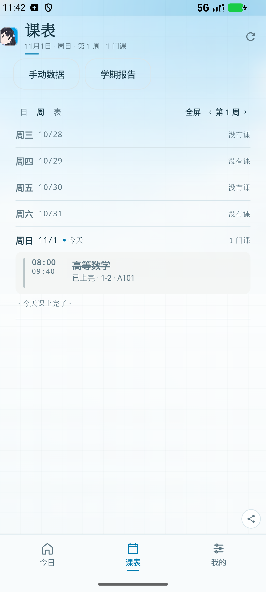

# Rin · 校园助手

Rin 是一个给 GDUPT 同学准备的校园助手客户端：课程表、上课提醒、签到提醒、天气、速记，和一点陪伴。

这是一个**本地优先的客户端展示版**：课表由使用者自己录入，提醒和数据都留在本机，不需要账号。



## 能做什么

- **课程表**：手动添加课程、教室、节次与周次；周表、列表和学期报告随时切换。
- **上课提醒**：为具体课程设置本机提醒，提前量、铃声、音量和震动都可以调。
- **签到提醒**：上课前在本机提醒你留意签到。
- **今日**：Rin 问候、Mini 课表、逐小时与 24 小时天气、速记、考试倒计时、相框。
- **外观**：16 套主题、自定义封面、强调色、圆角、装饰，以及 Rin 的通知表情。
- **隐私**：没有账号、没有登录、没有埋点；课表、提醒、头像与封面只保存在应用私有目录。天气是唯一的网络请求，使用固定城市坐标，不申请定位权限。

## 目录

```
android/   Kotlin + Jetpack Compose 客户端
design/    设计 token
```

## 构建

需要 JDK 17+、Android SDK 35。

```bash
cd android
# 指向本机 Android SDK 后执行
./gradlew :app:assembleDebug
```

APK 输出在 `android/app/build/outputs/apk/debug/`。

## 说明

Rin 的提醒全部由 Android 本机通知与闹钟完成。课程时间、周次和地点以你录入的内容为准。
